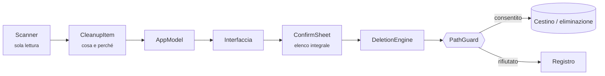

<div align="center">


# Ammugghia

**Pulizia del disco per macOS, nativa, pensata per chi sviluppa — e che nel dubbio rifiuta.**

<sub><i>Ammugghia</i> viene dal siciliano <i>ammugghiari</i>: avvolgere, accartocciare — il gesto
che si fa con un foglio di carta prima di buttarlo.</sub>

[](https://github.com/Mingo07-dev/Ammugghia/actions/workflows/ci.yml)


[](LICENSE)

[English](README.md) · **Italiano**

</div>

---

## Perché

Su un MacBook Air da 228 GB, macOS dichiarava **100 GB di «dati di sistema»** e il Finder
non ne mostrava nessuno. Erano in gran parte runtime dei simulatori iOS, residui di Xcode
e cache dei gestori di pacchetti, nascosti in posti dove né un utente né la maggior parte
dei programmi di pulizia guardano.

Ammugghia nasce da quella pulizia fatta a mano. Trova lo spazio, spiega per ogni elemento
che cos'è e che cosa succede dopo averlo eliminato, e lascia a te la decisione.

> [!IMPORTANT]
> Ammugghia elimina file, e tutto il progetto parte da qui: **in caso di dubbio l'operazione
> viene rifiutata, non eseguita.** La modalità predefinita è «Sposta nel Cestino», quindi
> ogni operazione è reversibile.

## In breve

- **Pensata per il Mac di chi sviluppa.** Xcode, simulatori iOS, SDK Android, Gradle,
  CocoaPods, npm/Yarn/pnpm, pip, Cargo, Go, Homebrew, Docker e artefatti di build
  raggruppati per progetto.
- **Ogni elemento si spiega.** Mostra che cos'è, i percorsi esatti, l'ultima attività e
  *che cosa succede dopo*. Un elemento che non sa spiegarsi non viene mostrato.
- **Strumenti ufficiali prima di tutto.** `simctl` per i simulatori, `brew cleanup` per
  Homebrew, `docker … prune` per Docker: gli indici interni di quei programmi restano
  coerenti.
- **Versioni multiple.** Trova runtime dei simulatori duplicati, più installazioni di Xcode,
  NDK, JDK, versioni di Python e Node, SDK Flutter e app installate due volte, e suggerisce
  quale tenere.
- **Disinstallazione completa.** Trova tutto ciò che un'app lascia sul disco, ogni voce con
  il proprio livello di affidabilità.
- **Tutto in locale.** Nessuna rete, nessuna telemetria, nessun account. Nessun dato lascia
  il Mac.
- **Nativa e senza dipendenze.** SwiftUI e Swift Package Manager, senza codice di terze
  parti.

## Cosa analizza

| Categoria | Contenuto |
|---|---|
| **Xcode** | DerivedData per progetto, simboli dei dispositivi per versione di OS, archivi, cache dei moduli e dell'indice, anteprime SwiftUI, cache SwiftPM e CocoaPods, cache dyld dei simulatori, Command Line Tools duplicati |
| **Simulatori iOS** | Dispositivi con e senza dati, con la data dell'ultimo avvio. Eliminazione e azzeramento sono alternative che si escludono a vicenda |
| **Android** | NDK, immagini di sistema, emulatori, sorgenti, cache Gradle e distribuzioni del wrapper |
| **Gestori di pacchetti** | npm, Yarn, pnpm, pip, Homebrew, node-gyp, pub/Dart, Maven, Cargo, RubyGems, Go |
| **Artefatti dei progetti** | `node_modules`, `Pods`, `.dart_tool`, `build`, `.next`… raggruppati per progetto. Una cartella viene proposta solo se il progetto ha un file manifest corrispondente |
| **Browser** | Solo le cartelle di cache di Chrome, Edge, Brave, Arc, Opera, Firefox e Safari. Cronologia, segnalibri, password e sessioni restano intatti |
| **Sistema** | Installer di macOS residuo, cache delle app, stato delle finestre, log, allegati di Mail, backup dei dispositivi iOS, Cestino |
| **Sfondi dinamici** | Video 4K degli sfondi animati. Ammugghia legge **prima** la configurazione: se la rotazione è ancora attiva, avvisa che macOS li riscaricherebbe |
| **Docker** | Immagini non usate, container fermi, cache di build. **I volumi sono mostrati in sola lettura e non vengono mai eliminati** |
| **File grandi** | Elenco dei file più grandi nelle cartelle personali. Si possono solo mostrare nel Finder: Ammugghia non li elimina mai |

## Il modello di sicurezza

Ogni eliminazione segue lo stesso percorso, e nessuno scanner può eliminare da solo:



**Doppia barriera.** Ogni percorso deve rientrare in un elenco di aree consentite *e* non
rientrare fra le aree protette. Aggiungere uno scanner non allarga i permessi: un percorso
fuori dall'elenco viene rifiutato. `DeletionEngine` ricontrolla anche ciò che
l'interfaccia ha già validato.

**Due livelli di protezione.**

- *Assoluta.* Nessuna operazione può mai toccare: libreria Foto, iCloud Drive,
  portachiavi, Mail, Messaggi, Contatti, Calendario, cronologia di Safari, backup dei
  dispositivi iOS, chiavi SSH e GPG, credenziali cloud, `~/.config`, `/System`, `/usr`,
  `/etc`, file di swap, dischi esterni.
- *Aree documenti.* Documenti, Scrivania, Download e Filmati sono bloccate per qualsiasi
  eliminazione generica. L'unica eccezione sono gli artefatti di build, che devono superare
  una prova doppia: nome della cartella in un elenco chiuso **e** file di progetto
  riconoscibile nella cartella padre. Così una cartella `build` non viene scambiata per
  codice sorgente.

**Altre garanzie.**

- I collegamenti simbolici vengono validati anche nella destinazione: un link in una cache
  che punta a `~/Documents` non passa.
- «Sposta nel Cestino» è la modalità predefinita. Per eliminare definitivamente dati non
  recuperabili bisogna digitare `ELIMINA`.
- Nessun elemento a rischio è preselezionato, e un avvertimento esclude la preselezione
  anche per una cache sicura.
- «Simula» esegue tutti i controlli e mostra l'esito senza toccare il disco.
- Le operazioni da amministratore mostrano il comando letterale prima di chiedere la
  password, e passano comunque dai controlli: la password non è un lasciapassare.
- Le app in esecuzione non vengono disinstallate.
- I processi esterni ricevono sempre argomenti separati, mai una stringa passata a una
  shell: un nome di file con apici o spazi non può essere reinterpretato.
- Ogni operazione, compresi i rifiuti, finisce in `~/Library/Logs/Ammugghia`.

> [!NOTE]
> `docker volume prune` e l'opzione `--volumes` **non sono implementati di proposito**. I
> volumi contengono database e stato delle applicazioni, e un comando trovato online può
> distruggerli in un attimo.

### La prova: `--selftest`

```bash
Ammugghia --selftest
```

Esegue **53 controlli** senza aprire l'interfaccia:

- percorsi che devono essere rifiutati: libreria Foto, iCloud Drive, chiavi SSH,
  `/System`, la cartella utente…
- percorsi che devono essere consentiti;
- un'eliminazione reale su un file creato per l'occasione;
- un percorso protetto mandato direttamente al motore, saltando l'interfaccia.

Se un solo controllo non passa, la build non va usata. La CI lo esegue a ogni push.

## Installazione

Requisiti: **macOS 14 Sonoma o successivo**, e Xcode oppure gli strumenti a riga di comando.

```bash
git clone https://github.com/Mingo07-dev/Ammugghia.git
cd Ammugghia
./build.sh              # costruisce dist/Ammugghia.app
./build.sh --install    # installa in /Applications e avvia
```

L'app ha una firma ad-hoc: al primo avvio usa clic destro → **Apri**.

### Accesso completo al disco

Alcune aree, come la cache di Safari e certi container, sono protette da macOS. Se
un'eliminazione non riesce per «permesso negato», concedi **Accesso completo al disco** ad
Ammugghia in *Impostazioni di Sistema → Privacy e sicurezza*. Il messaggio d'errore lo dice
esplicitamente, invece di fallire in silenzio.

## Riga di comando

```bash
Ammugghia --report     # analisi completa stampata nel terminale, non modifica nulla
Ammugghia --selftest   # verifica che le protezioni rifiutino i percorsi pericolosi
```

L'eseguibile si trova in `$(swift build -c release --show-bin-path)/Ammugghia`, oppure in
`Ammugghia.app/Contents/MacOS/Ammugghia`.

## Struttura

```
Sources/Ammugghia/
  Model/   Model.swift            tipi, livelli di rischio, azioni
           AppModel.swift         stato dell'interfaccia, orchestrazione
  Core/    PathGuard.swift        il cancello di sicurezza
           DeletionEngine.swift   esecuzione, backup, registro
           Shell.swift            processi esterni, misura delle dimensioni
           SelfTest.swift         verifica delle protezioni
           Report.swift           analisi da terminale
  Scan/    un file per famiglia di scanner
  UI/      viste SwiftUI
Tools/     MakeIcon.swift         l'icona, disegnata da codice con CoreGraphics
```

L'icona è un portatile con una scopa. La disegna `Tools/MakeIcon.swift` invece di
importarla come immagine: resta nitida a ogni dimensione, non aggiunge file binari da
mantenere e si modifica cambiando qualche coordinata.

## Prossimi passi

- [ ] Verifica dell'identità di ogni file (dispositivo + inode) fra analisi ed eliminazione
- [ ] Cache delle app Electron (Slack, Discord, VS Code, Teams…) e altri gestori di pacchetti
- [ ] Residui di app già disinstallate e modelli AI locali (Ollama, Hugging Face, LM Studio)
- [ ] Mappa del disco (treemap) con indice incrementale basato su FSEvents
- [ ] File duplicati per contenuto (solo «Mostra nel Finder»)
- [ ] Elementi d'avvio: elenco, disattivazione e riattivazione
- [ ] Cronologia delle pulizie con ripristino dal Cestino, ed esclusioni personalizzate

## Contribuire

Segnalazioni e pull request sono benvenute, in italiano o in inglese.

- Esegui `Ammugghia --selftest` prima di ogni pull request. Uno scanner che tocca un'area
  nuova richiede casi nuovi in `Core/SelfTest.swift`.
- La build deve restare a **zero warning**.
- Ogni elemento nuovo deve spiegare la propria `consequence` e mostrare i percorsi esatti.
- Preferisci lo strumento ufficiale all'eliminazione diretta dei file.
- I messaggi di commit seguono [Conventional Commits](https://www.conventionalcommits.org/it/).
- L'interfaccia è in italiano: i testi rivolti all'utente restano in italiano, con singolare
  e plurale gestiti.

## Ringraziamenti

Alcune idee dei prossimi passi sono ispirate a [MangoDisk](https://github.com/harry0703/MangoDisk),
programma di pulizia open source multipiattaforma. Ammugghia non ne condivide il codice.

## Licenza

[MIT](LICENSE) © 2026 Marco Sajeva
