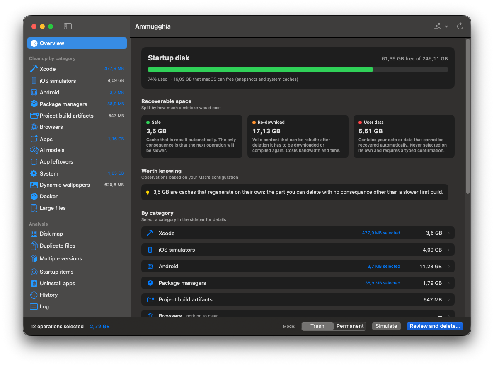
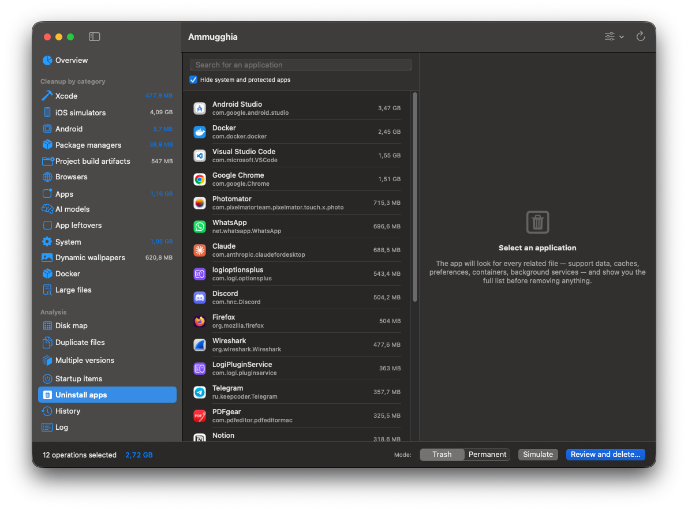
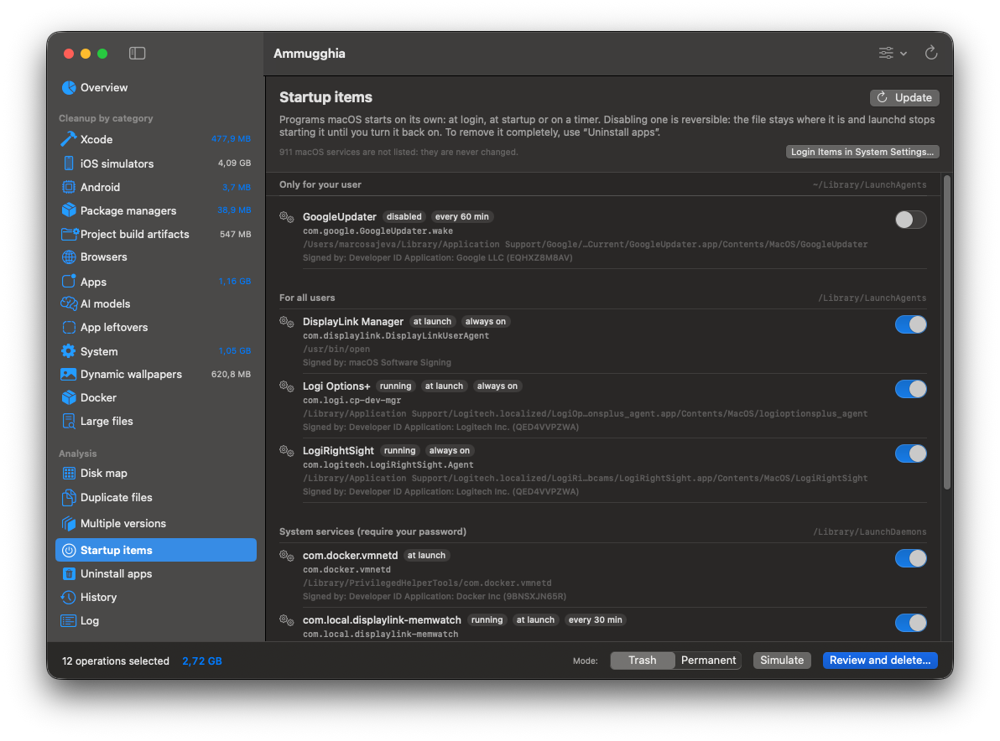
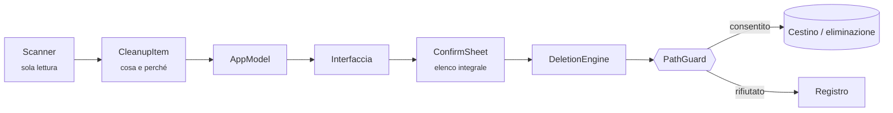

<div align="center">


# Ammugghia

**Pulizia del disco per macOS, nativa, pensata per chi sviluppa — e che nel dubbio rifiuta.**

<sub><i>Ammugghia</i> viene dal siciliano <i>ammugghiari</i>: avvolgere, accartocciare — il gesto
che si fa con un foglio di carta prima di buttarlo. Vuol dire anche raccattare, sistemare,
come in <i>ammugghiari a tovagghia</i>: raccogliere la tovaglia a fine pasto.</sub>

[](https://github.com/Mingo07-dev/Ammugghia/releases/latest)
[](https://github.com/Mingo07-dev/Ammugghia/actions/workflows/ci.yml)


[](LICENSE)

**[⬇ Scarica per macOS](https://github.com/Mingo07-dev/Ammugghia/releases/latest)** · `brew install --cask mingo07-dev/tap/ammugghia` · firmata e notarizzata · macOS 14+

[English](README.md) · **Italiano**

</div>

<p align="center">
  
</p>

---

## Perché

Su un MacBook Air da 228 GB, macOS dichiarava **100 GB di «dati di sistema»** e il Finder
non ne mostrava nessuno. Erano in gran parte runtime dei simulatori iOS, residui di Xcode
e cache dei gestori di pacchetti, nascosti in posti dove né un utente né la maggior parte
dei programmi di pulizia guardano.

Ammugghia nasce da quella pulizia fatta a mano. Trova lo spazio, spiega per ogni elemento
che cos'è e che cosa succede dopo averlo eliminato, e lascia a te la decisione.

> [!IMPORTANT]
> Ammugghia elimina file, e tutto il progetto parte da qui: **in caso di dubbio l'operazione
> viene rifiutata, non eseguita.** La modalità predefinita è «Sposta nel Cestino», quindi
> ogni operazione è reversibile.

## In breve

- **Pensata per il Mac di chi sviluppa.** Xcode, simulatori iOS, SDK Android, Gradle,
  CocoaPods, npm/Yarn/pnpm, pip, Cargo, Go, Homebrew, Docker e artefatti di build
  raggruppati per progetto.
- **Ogni elemento si spiega.** Mostra che cos'è, i percorsi esatti, l'ultima attività e
  *che cosa succede dopo*. Un elemento che non sa spiegarsi non viene mostrato.
- **Strumenti ufficiali prima di tutto.** `simctl` per i simulatori, `brew cleanup` per
  Homebrew, `docker … prune` per Docker: gli indici interni di quei programmi restano
  coerenti.
- **Versioni multiple.** Trova runtime dei simulatori duplicati, più installazioni di Xcode,
  NDK, JDK, versioni di Python e Node, SDK Flutter e app installate due volte, e suggerisce
  quale tenere.
- **Disinstallazione completa.** Trova tutto ciò che un'app lascia sul disco, ogni voce con
  il proprio livello di affidabilità.
- **Tutto in locale.** Nessuna rete, nessuna telemetria, nessun account. Nessun dato lascia
  il Mac.
- **In italiano e in inglese.** Segue la lingua del Mac, oppure quella scelta per la singola
  app nelle Impostazioni di Sistema.
- **Nativa e senza dipendenze.** SwiftUI e Swift Package Manager, senza codice di terze
  parti.

## Cosa analizza

| Categoria | Contenuto |
|---|---|
| **Xcode** | DerivedData per progetto, simboli dei dispositivi per versione di OS, archivi, cache dei moduli e dell'indice, anteprime SwiftUI, cache SwiftPM e CocoaPods, cache dyld dei simulatori, Command Line Tools duplicati |
| **Simulatori iOS** | Dispositivi con e senza dati, con la data dell'ultimo avvio. Eliminazione e azzeramento sono alternative che si escludono a vicenda |
| **Android** | NDK, immagini di sistema, emulatori, sorgenti, cache Gradle e distribuzioni del wrapper |
| **Gestori di pacchetti** | npm, npx, Yarn, pnpm, Bun, Deno, Corepack, pip, uv, Poetry, pyenv, ruff/mypy, Homebrew, node-gyp, pub/Dart, Maven, Gradle, sbt/Ivy, Cargo, RubyGems, Go, Composer, NuGet, Hex, mise, ccache/sccache, browser di Playwright/Cypress, download di Electron |
| **Artefatti dei progetti** | `node_modules`, `Pods`, `.dart_tool`, `build`, `.next`… raggruppati per progetto. Anche `target` (Rust, Maven), `.build` (Swift), cache Python, Unity, Godot, Zig, Terraform e altri. Ogni nome è legato al proprio manifest: `target` viene proposto solo accanto a `Cargo.toml` o `pom.xml` |
| **Browser** | Solo le cartelle di cache di Chrome, Edge, Brave, Arc, Opera, Firefox e Safari. Cronologia, segnalibri, password e sessioni restano intatti |
| **App** | Cache del motore web delle app Electron/Chromium: Slack, Discord, Teams, VS Code, Cursor, Windsurf, Notion, Obsidian, Figma, Postman, Claude… I contenuti offline sono una voce a parte. Anche IDE JetBrains, Android Studio, Spotify, Microsoft Office, cache multimediale di Adobe. Messaggi, documenti, accessi e impostazioni non vengono mai toccati, e l'app deve essere chiusa |
| **Modelli AI** | Ollama (rimossi con il comando ufficiale `ollama rm`, tenendo conto dei livelli condivisi), Hugging Face, LM Studio, PyTorch Hub, Whisper, Keras: una voce per modello, con l'ultima attività |
| **Residui di app** | Container, preferenze, cache e stato delle finestre di app non più installate. Un'app risulta rimossa solo se nessuna app installata o bundle annidato, nessuna app registrata nel sistema e nessun processo in esecuzione le corrisponde, e se nessuno ha usato il suo container negli ultimi 14 giorni. Si raccolgono solo i file con il nome esatto dell'identificatore |
| **Sistema** | Installer di macOS residuo, cache delle app, cache dei servizi di sistema, stato delle finestre, log, allegati di Mail, backup dei dispositivi iOS, Cestino. File nelle cartelle temporanee e di cache di `/var/folders` non usati da 7 giorni, ognuno ricontrollato prima di eliminarlo. I download interrotti sono solo elencati |
| **Sfondi dinamici** | Video 4K degli sfondi animati. Ammugghia legge **prima** la configurazione: se la rotazione è ancora attiva, avvisa che macOS li riscaricherebbe |
| **Docker** | Immagini non usate, container fermi, cache di build. **I volumi sono mostrati in sola lettura e non vengono mai eliminati** |
| **File grandi** | Elenco dei file più grandi nelle cartelle personali. Si possono solo mostrare nel Finder: Ammugghia non li elimina mai |

<table>
  <tr>
    <td width="50%"></td>
    <td width="50%"></td>
  </tr>
  <tr>
    <td align="center"><sub>Disinstallazione completa</sub></td>
    <td align="center"><sub>Elementi d'avvio, con firma e stato</sub></td>
  </tr>
</table>

## Mappa del disco

Una treemap di tutto il Mac (cartella utente, Applicazioni, Libreria, Homebrew), con ogni
area proporzionale allo spazio che occupa. Doppio clic per entrare in una cartella. Il
pannello laterale mostra dimensione, numero di file e ultima attività, e porta alla voce di
pulizia di quella cartella. La mappa **serve solo a vedere**: si elimina sempre dalle
categorie, dove ogni voce spiega che cosa succede dopo.

La prima lettura richiede circa 30 secondi. Poi Ammugghia salva un indice e, grazie alla
storia delle modifiche di macOS (FSEvents), rilegge **solo le cartelle cambiate**: di solito
circa un secondo. L'indice serve solo a mostrare, quindi non decide mai un'eliminazione. Si
rifà da zero ogni volta che la storia non è affidabile:
- eventi persi;
- volume o database degli eventi cambiati;
- macOS aggiornato;
- permessi cambiati;
- indice più vecchio di un giorno;
- un campione di cartelle a caso che non corrisponde più al disco.

```bash
Ammugghia --index          # aggiorna l'indice e ne stampa un riepilogo
Ammugghia --verify-index   # confronta l'indice aggiornato con un'analisi completa
```

## File duplicati

File con contenuto identico byte per byte nelle cartelle personali, confermato dall'impronta
SHA-256 dell'intero file.
- **Come vengono trovati.** Prima si confrontano le dimensioni, poi tre campioni da 16 KiB.
  Un file viene letto per intero solo se i campioni coincidono. Le impronte restano in
  memoria, quindi la seconda ricerca è quasi immediata.
- **Cosa viene escluso.** Collegamenti fisici e simbolici, segnaposto di iCloud, pacchetti
  delle app come la libreria Foto, e cartelle di build.
- **Lo spazio recuperabile è reale.** Le copie fatte dal Finder sono cloni APFS e
  condividono i blocchi. Ammugghia chiede ad APFS quali copie sono cloni, così non promette
  mai spazio che eliminandole non si libera.
- **Si possono solo mostrare nel Finder**, come i file grandi: la copia da tenere la scegli
  tu.

```bash
Ammugghia --duplicates   # elenca i gruppi di duplicati; legge i file, non modifica nulla
```

## Elementi d'avvio

Tutto ciò che launchd avvia da solo, da `~/Library/LaunchAgents`, `/Library/LaunchAgents` e
`/Library/LaunchDaemons`. Per ogni elemento vedi:
- l'app a cui appartiene e chi l'ha firmato;
- se parte all'accesso, resta sempre attivo o si ripete a intervalli, e se è in esecuzione
  adesso;
- se è orfano: il programma che dovrebbe avviare non esiste più, perché l'app è stata
  rimossa.

Ogni elemento si può disattivare e riattivare. Disattivare è reversibile: il file resta dov'è,
e `launchctl disable` più `bootout` lo fermano finché non lo riaccendi. Ogni modifica mostra
prima i comandi letterali, chiede la password di amministratore solo per i servizi di sistema,
e viene verificata rileggendo lo stato da launchd. I servizi di macOS (`com.apple.*`) sono
solo contati e non vengono mai toccati.

```bash
Ammugghia --startup   # elenca gli elementi d'avvio, non modifica nulla
```

## Confronto con le alternative

Per parti di questo lavoro esistono buoni strumenti. Ammugghia si concentra sui posti dove un
Mac da sviluppo nasconde lo spazio, e spiega ogni eliminazione prima di farla.

| | Obiettivo | Prezzo | Open source |
|---|---|---|---|
| **Ammugghia** | Cache e residui dello sviluppo, con una pulizia spiegata che nel dubbio rifiuta; mappa del disco; duplicati; elementi d'avvio | Gratis | Sì (MIT) |
| [DevCleaner for Xcode](https://github.com/vashpan/xcode-dev-cleaner) | Cache di Xcode, simboli dei dispositivi, archivi, simulatori | Gratis | Sì |
| [GrandPerspective](https://grandperspectiv.sourceforge.net) · [OmniDiskSweeper](https://www.omnigroup.com/more) · [DaisyDisk](https://daisydiskapp.com) | Vedere dove va lo spazio; cosa eliminare lo decidi tu | Gratis · Gratis · A pagamento | Solo GrandPerspective |
| [CleanMyMac](https://macpaw.com/cleanmymac) | Pulizia e manutenzione generale del Mac | Abbonamento | No |
| [MangoDisk](https://github.com/harry0703/MangoDisk) | Pulizia multipiattaforma con cataloghi di regole e funzioni online facoltative | Gratis | Sì |

## Il modello di sicurezza

Ogni eliminazione segue lo stesso percorso, e nessuno scanner può eliminare da solo:



**Doppia barriera.** Ogni percorso deve rientrare in un elenco di aree consentite *e* non
rientrare fra le aree protette. Aggiungere uno scanner non allarga i permessi: un percorso
fuori dall'elenco viene rifiutato. `DeletionEngine` ricontrolla anche ciò che
l'interfaccia ha già validato.

**Due livelli di protezione.**

- *Assoluta.* Nessuna operazione può mai toccare: libreria Foto, iCloud Drive,
  portachiavi, Mail, Messaggi, Contatti, Calendario, cronologia di Safari, backup dei
  dispositivi iOS, chiavi SSH e GPG, credenziali cloud, `~/.config`, `/System`, `/usr`,
  `/etc`, file di swap, dischi esterni.
- *Aree documenti.* Documenti, Scrivania, Download e Filmati sono bloccate per qualsiasi
  eliminazione generica. L'unica eccezione sono gli artefatti di build, che devono superare
  una prova doppia: nome della cartella in un elenco chiuso **e** file di progetto
  riconoscibile nella cartella padre. Così una cartella `build` non viene scambiata per
  codice sorgente.

**Altre garanzie.**

- **Il percorso deve essere ancora lo stesso oggetto.** Dispositivo e inode di ogni
  percorso vengono registrati durante l'analisi e ricontrollati subito prima di
  eliminare. Una cartella sostituita nel frattempo, anche da una con lo stesso nome,
  viene rifiutata, come una cartella che contiene un volume montato.
- **Prima si chiudono le app.** Le cache dei browser e l'indice di Xcode non vengono
  toccati finché il programma è aperto. Il foglio di conferma elenca le app aperte e
  offre di chiuderle.
- I collegamenti simbolici vengono validati anche nella destinazione: un link in una cache
  che punta a `~/Documents` non passa.
- «Sposta nel Cestino» è la modalità predefinita. Per eliminare definitivamente dati non
  recuperabili bisogna digitare `ELIMINA`.
- Nessun elemento a rischio è preselezionato, e un avvertimento esclude la preselezione
  anche per una cache sicura.
- «Simula» esegue tutti i controlli e mostra l'esito senza toccare il disco.
- Le operazioni da amministratore mostrano il comando letterale prima di chiedere la
  password, e passano comunque dai controlli: la password non è un lasciapassare.
- Le app in esecuzione non vengono disinstallate.
- I processi esterni ricevono sempre argomenti separati, mai una stringa passata a una
  shell: un nome di file con apici o spazi non può essere reinterpretato.
- Ogni operazione, compresi i rifiuti, finisce in `~/Library/Logs/Ammugghia`.
- **Cronologia con ripristino.** Ogni operazione reale viene registrata con lo spazio
  liberato. Ciò che Ammugghia ha spostato nel Cestino si può rimettere al suo posto dalla
  vista Cronologia. Il ripristino si limita a spostare: non sovrascrive, non crea cartelle e
  parte solo da un Cestino vero.
- **Le tue esclusioni.** Nelle Impostazioni (⌘,) puoi escludere cartelle, file o schemi sul
  nome da pulizia, file grandi, duplicati e mappa. Le esclusioni possono solo togliere
  percorsi, mai aggiungerne. Il motore rifiuta un percorso escluso anche se l'interfaccia lo
  lasciasse passare, e rifiuta qualsiasi cartella che contiene qualcosa di escluso.

> [!NOTE]
> `docker volume prune` e l'opzione `--volumes` **non sono implementati di proposito**. I
> volumi contengono database e stato delle applicazioni, e un comando trovato online può
> distruggerli in un attimo.

### La prova: `--selftest`

```bash
Ammugghia --selftest
```

Esegue **103 controlli** senza aprire l'interfaccia:

- percorsi che devono essere rifiutati: libreria Foto, iCloud Drive, chiavi SSH,
  `/System`, la cartella utente…
- percorsi che devono essere consentiti;
- un'eliminazione reale su un file creato per l'occasione;
- un percorso protetto mandato direttamente al motore, saltando l'interfaccia.

Se un solo controllo non passa, la build non va usata. La CI lo esegue a ogni push.

## Installazione

Richiede **macOS 14 Sonoma o successivo**, su Apple silicon o Intel.

### Homebrew

```bash
brew install --cask mingo07-dev/tap/ammugghia
```

Si aggiorna con `brew upgrade --cask ammugghia`.

### Scaricarla

Oppure scarica l'ultimo `Ammugghia-x.y.z.dmg` dalla
**[pagina delle Release](https://github.com/Mingo07-dev/Ammugghia/releases/latest)**, aprilo e
trascina Ammugghia in Applicazioni. L'app è firmata con un Developer ID e notarizzata da Apple,
quindi si apre con un normale doppio clic. Ogni Release riporta anche l'impronta SHA-256 del DMG.

### Compilarla dai sorgenti

Serve Xcode oppure gli strumenti a riga di comando.

```bash
git clone https://github.com/Mingo07-dev/Ammugghia.git
cd Ammugghia
./build.sh              # costruisce dist/Ammugghia.app
./build.sh --install    # installa in /Applications e avvia
```

Una build fatta così ha una firma ad-hoc ed è pensata solo per il tuo Mac.

### Accesso completo al disco

Alcune aree, come la cache di Safari e certi container, sono protette da macOS. Se
un'eliminazione non riesce per «permesso negato», concedi **Accesso completo al disco** ad
Ammugghia in *Impostazioni di Sistema → Privacy e sicurezza*. Il messaggio d'errore lo dice
esplicitamente, invece di fallire in silenzio.

## Riga di comando

```bash
Ammugghia --report     # analisi completa stampata nel terminale, non modifica nulla
Ammugghia --selftest   # verifica che le protezioni rifiutino i percorsi pericolosi
Ammugghia --index      # aggiorna l'indice della mappa del disco e ne stampa un riepilogo
```

L'eseguibile si trova in `$(swift build -c release --show-bin-path)/Ammugghia`, oppure in
`Ammugghia.app/Contents/MacOS/Ammugghia`.

## Struttura

```
Sources/Ammugghia/
  Model/   Model.swift            tipi, livelli di rischio, azioni
           AppModel.swift         stato dell'interfaccia, orchestrazione
  Core/    PathGuard.swift        il cancello di sicurezza
           DeletionEngine.swift   esecuzione, backup, registro
           Shell.swift            processi esterni, misura delle dimensioni
           SelfTest.swift         verifica delle protezioni
           Report.swift           analisi da terminale
  Scan/    un file per famiglia di scanner
  UI/      viste SwiftUI
Tools/     MakeIcon.swift         l'icona, disegnata da codice con CoreGraphics
```

L'icona è un portatile con una scopa. La disegna `Tools/MakeIcon.swift` invece di
importarla come immagine: resta nitida a ogni dimensione, non aggiunge file binari da
mantenere e si modifica cambiando qualche coordinata.

## Prossimi passi

- [x] Controllo dell'identità dei file, cache delle app Electron, residui di app e modelli AI,
  mappa del disco con indice incrementale, duplicati, elementi d'avvio, cronologia ed
  esclusioni, interfaccia in inglese, release firmate e notarizzate, tap Homebrew
- [ ] Cask ufficiale di Homebrew, quando il progetto avrà i requisiti
- [ ] Altre aree da pulire: proponile in una
  [issue](https://github.com/Mingo07-dev/Ammugghia/issues/new/choose), con il percorso esatto e
  cosa succede dopo averle eliminate

## Contribuire

Segnalazioni e pull request sono benvenute, in italiano o in inglese.

- Esegui `Ammugghia --selftest` prima di ogni pull request. Uno scanner che tocca un'area
  nuova richiede casi nuovi in `Core/SelfTest.swift`.
- La build deve restare a **zero warning**.
- Ogni elemento nuovo deve spiegare la propria `consequence` e mostrare i percorsi esatti.
- Preferisci lo strumento ufficiale all'eliminazione diretta dei file.
- I messaggi di commit seguono [Conventional Commits](https://www.conventionalcommits.org/it/).
- L'interfaccia è in italiano e in inglese. L'italiano è la lingua di partenza: i nuovi testi
  rivolti all'utente passano da `String(localized:)` (o da un testo letterale SwiftUI), e la
  traduzione inglese va in `Resources/Localization/en.lproj/Localizable.strings`.
  `Tools/check-localization.sh` elenca le traduzioni mancanti, e la CI fallisce se ne manca
  una.

## Ringraziamenti

Alcune idee dei prossimi passi sono ispirate a [MangoDisk](https://github.com/harry0703/MangoDisk),
programma di pulizia open source multipiattaforma. Ammugghia non ne condivide il codice.

## Licenza

[MIT](LICENSE) © 2026 Marco Sajeva
