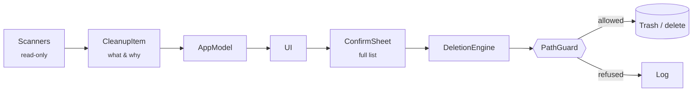

<div align="center">


# Ammugghia

**A native macOS disk cleaner for developers — one that refuses rather than guesses.**

<sub><i>Ammugghia</i> comes from the Sicilian verb <i>ammugghiari</i>: to wrap up, to crumple —
what you do to a sheet of paper right before throwing it away. It also means to gather up
and tidy, as in <i>ammugghiari a tovagghia</i>: folding up the tablecloth after a meal.</sub>

[](https://github.com/Mingo07-dev/Ammugghia/actions/workflows/ci.yml)


[](LICENSE)

**English** · [Italiano](README.it.md)

</div>

---

## Why

On a 228 GB MacBook Air, macOS reported **100 GB of "System Data"**. Finder could not
show any of it. Most of that space was iOS Simulator runtimes, Xcode leftovers and
package-manager caches, hidden in places that a normal user, or most cleaners, never
look at.

Ammugghia was born from cleaning that Mac by hand. It finds that space, explains what
each item is and what happens after it is gone, and then lets you decide.

> [!IMPORTANT]
> Ammugghia deletes files. Its whole design starts from that fact: **when in doubt, the
> operation is refused, not executed.** By default everything goes to the Trash, so every
> operation can be undone.

## Highlights

- **Built for developer Macs.** It covers Xcode, iOS Simulators, Android SDK, Gradle,
  CocoaPods, npm/Yarn/pnpm, pip, Cargo, Go, Homebrew, Docker and build artifacts,
  grouped by project.
- **Explains every item.** Each item shows what it is, its exact paths, its last activity
  and *what happens after deletion*. An item that cannot explain itself is not shown.
- **Uses the official tools.** `simctl` for simulators, `brew cleanup` for Homebrew,
  `docker … prune` for Docker, so their internal indexes stay consistent.
- **Multiple versions.** Finds duplicate simulator runtimes, Xcode installs, NDKs, JDKs,
  Python/Node versions, Flutter SDKs and apps installed twice. It suggests which one to
  keep.
- **Complete uninstaller.** Finds everything an app left behind: support data, caches,
  containers, launch agents and privileged helpers. Each match has a confidence level.
- **100% local.** No network, no telemetry, no account. Nothing ever leaves your Mac.
- **Native and dependency-free.** SwiftUI and Swift Package Manager, with no third-party
  code.

## What it scans

| Category | Contents |
|---|---|
| **Xcode** | DerivedData per project, device symbols per OS version, archives, module and index caches, SwiftUI previews, SwiftPM and CocoaPods caches, simulator dyld cache, duplicate Command Line Tools |
| **iOS Simulators** | Devices with and without data, with last boot date. *Delete* and *erase* are offered as mutually exclusive alternatives |
| **Android** | NDK, system images, emulators, sources, Gradle caches and wrapper distributions |
| **Package managers** | npm, npx, Yarn, pnpm, Bun, Deno, Corepack, pip, uv, Poetry, pyenv, ruff/mypy, Homebrew, node-gyp, pub/Dart, Maven, Gradle, sbt/Ivy, Cargo, RubyGems, Go, Composer, NuGet, Hex, mise, ccache/sccache, Playwright/Cypress browsers, Electron downloads |
| **Project artifacts** | `node_modules`, `Pods`, `.dart_tool`, `build`, `.next`… grouped by project. Also `target` (Rust, Maven), `.build` (Swift), Python caches, Unity, Godot, Zig, Terraform and more. Each folder name is tied to its own manifest: `target` is only offered next to `Cargo.toml` or `pom.xml` |
| **Browsers** | Cache folders only: Chrome, Edge, Brave, Arc, Opera, Firefox, Safari. History, bookmarks, passwords and sessions are never touched |
| **Apps** | Engine caches of Electron/Chromium apps: Slack, Discord, Teams, VS Code, Cursor, Windsurf, Notion, Obsidian, Figma, Postman, Claude… Offline content is a separate item. Also JetBrains IDEs, Android Studio, Spotify, Microsoft Office, Adobe Media Cache. Messages, documents, logins and settings are never touched, and the app must be closed |
| **System** | Leftover macOS installer, app caches, system service caches, saved window state, logs, Mail attachments, iOS device backups, Trash. Files in your `/var/folders` temp and cache folders that have not been used for 7 days, with each file re-checked before deletion. Interrupted downloads are listed for review only |
| **Dynamic wallpapers** | 4K Aerial videos. Ammugghia reads your wallpaper configuration **first**: if rotation is still on, it warns you that macOS will download them again |
| **Docker** | Unused images, stopped containers, build cache. **Volumes are shown read-only and never deleted** |
| **Large files** | List of the largest files in your personal folders. You can only reveal them in Finder; Ammugghia never deletes them |

## Safety model

Every deletion goes through the same path. No scanner can delete on its own:



**Double barrier.** A path must be inside an **allowlist** *and* outside the **protected**
list. Adding a new scanner does not widen permissions: if a path is not allowlisted, it is
refused. `DeletionEngine` checks again even for operations the UI has already validated.

**Two protection levels.**

- *Absolute.* No operation may ever touch these: the Photos library, iCloud Drive,
  Keychains, Mail, Messages, Contacts, Calendar, Safari history, iOS device backups, SSH
  and GPG keys, cloud credentials, `~/.config`, `/System`, `/usr`, `/etc`, swap files and
  external volumes.
- *Document areas.* Documents, Desktop, Downloads and Movies are blocked for any generic
  deletion. The only exception is build artifacts, which must pass a double check: a known
  folder name **and** a project manifest in the parent folder. This keeps a `build` folder
  from being mistaken for source code.

**More guarantees.**

- **The path must still be the same object.** The device and inode of each path are
  recorded at scan time and checked again right before deletion. If a folder was replaced
  in the meantime, even by one with the same name, it is refused. A folder that contains a
  mounted volume is refused too.
- **Apps must be closed first.** Browser caches and Xcode's index are not touched while
  their app is running. The confirmation sheet lists the open apps and offers to quit
  them.
- Symbolic links are validated at their destination too. A link in a cache folder that
  points to `~/Documents` is refused.
- **Move to Trash** is the default mode. Permanent deletion of user data requires typing
  `ELIMINA`.
- Nothing risky is preselected. An item with a warning is never preselected, even a safe
  cache.
- **Simulate** runs every check and shows the outcome without touching the disk.
- Administrator operations show the literal command before asking for your password, and
  they still go through every check. A password is not a free pass.
- Running apps are never uninstalled.
- External processes are always launched with separate arguments. No string is ever passed
  to a shell, so a filename with quotes cannot be reinterpreted.
- Every operation, refusals included, is logged to `~/Library/Logs/Ammugghia`.

> [!NOTE]
> `docker volume prune` and `--volumes` are **deliberately not implemented**. Volumes hold
> databases and application state, and a command copied from the internet can destroy
> them in seconds.

### Proving it: `--selftest`

```bash
Ammugghia --selftest
```

This runs **75 checks** without opening the UI:

- paths that must be refused: the Photos library, iCloud Drive, SSH keys, `/System`, your
  home folder…
- paths that must be allowed;
- a real deletion of a file created for the occasion;
- a protected path sent straight to the engine, bypassing the UI.

If a single check fails, the build must not be used. CI runs it on every push.

## Installation

Requirements: **macOS 14 Sonoma or later**, and Xcode or the Command Line Tools.

```bash
git clone https://github.com/Mingo07-dev/Ammugghia.git
cd Ammugghia
./build.sh              # builds dist/Ammugghia.app
./build.sh --install    # installs to /Applications and launches it
```

The app is signed ad hoc. On first launch, right-click it and choose **Open**.

### Full Disk Access

macOS protects some areas, such as the Safari cache and some containers. If a deletion
fails with "permission denied", grant **Full Disk Access** to Ammugghia in *System Settings
→ Privacy & Security*. Ammugghia says so in the error message instead of failing silently.

## Command line

```bash
Ammugghia --report     # full analysis printed to the terminal; changes nothing
Ammugghia --selftest   # verifies that the protections refuse dangerous paths
```

The binary lives at `$(swift build -c release --show-bin-path)/Ammugghia`, or at
`Ammugghia.app/Contents/MacOS/Ammugghia`.

## Project structure

```
Sources/Ammugghia/
  Model/   Model.swift            types, risk levels, actions
           AppModel.swift         UI state, orchestration
  Core/    PathGuard.swift        the safety gate
           DeletionEngine.swift   execution, backups, log
           Shell.swift            external processes, size measurement
           SelfTest.swift         protection checks
           Report.swift           terminal analysis
  Scan/    one file per scanner family
  UI/      SwiftUI views
Tools/     MakeIcon.swift         the app icon, drawn in code with CoreGraphics
```

The icon is drawn by `Tools/MakeIcon.swift` instead of being imported as an image. It stays
sharp at every size, adds no binary files to maintain, and can be changed by editing a few
coordinates.

## Roadmap

- [x] Verify each file's identity (device + inode) between scan and deletion
- [x] Caches of Electron apps (Slack, Discord, VS Code, Teams…) and more package managers
- [ ] Leftovers of apps that are already uninstalled, and local AI models (Ollama, Hugging Face, LM Studio)
- [ ] Disk map (treemap) with an incremental index based on FSEvents
- [ ] Duplicate files by content (reveal only)
- [ ] Startup items: list, disable and re-enable
- [ ] Cleanup history with restore from Trash, and user-defined exclusions

## Contributing

Issues and pull requests are welcome, in English or Italian.

- Run `Ammugghia --selftest` before every pull request. A scanner that touches a new area
  needs new test cases in `Core/SelfTest.swift`.
- The build must stay at **zero warnings**.
- Every new item must explain its `consequence` and show its exact paths.
- Prefer the official tool over deleting files directly.
- Commit messages follow [Conventional Commits](https://www.conventionalcommits.org/).
- The UI is in Italian. Keep user-facing text in Italian and handle singular and plural.

## Acknowledgements

Some ideas on the roadmap are inspired by [MangoDisk](https://github.com/harry0703/MangoDisk),
an open-source, cross-platform disk cleaner. Ammugghia shares no code with it.

## License

[MIT](LICENSE) © 2026 Marco Sajeva
